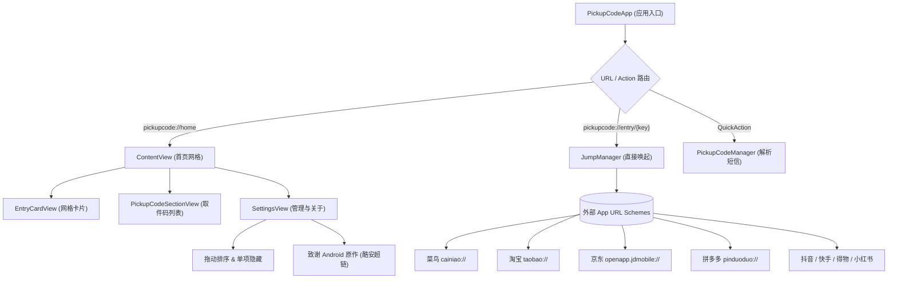

# 📦 取件快码 for iOS (PickupCode)
## 项目交付与架构设计白皮书 (HANDOFF & Architecture Document)

> **版本**：v2.1.5 (Build 2026.11.14)  
> **文档性质**：项目交接指南、系统架构设计、核心技术剖析与演进规划  
> **编写日期**：2026-11-14  
> **仓库地址**：`git@github.com:As-langs/PickupCode-iOS.git`

---

## 目录 (Table of Contents)

- [1. 项目概览与设计哲学](#1-项目概览与设计哲学)
  - [1.1 诞生背景与设计哲学](#11-诞生背景与设计哲学)
  - [1.2 原作者与版权致谢规范](#12-原作者与版权致谢规范)
- [2. 系统全景架构与技术栈](#2-系统全景架构与技术栈)
  - [2.1 整体分层架构](#21-整体分层架构)
  - [2.2 模块拓扑关系](#22-模块拓扑关系)
  - [2.3 技术选型一览](#23-技术选型一览)
- [3. 核心功能与关键代码剖析](#3-核心功能与关键代码剖析)
  - [3.1 跨平台 URL Scheme 路由调度中心 (`JumpManager.swift` & `Models.swift`)](#31-跨平台-url-scheme-路由调度中心-jumpmanagerswift--modelsswift)
  - [3.2 智能短信取件码正则解析引擎 (`PickupCodeManager.swift`)](#32-智能短信取件码正则解析引擎-pickupcodemanagerswift)
  - [3.3 响应式多列网格与主题系统 (`ThemeManager.swift` & `ContentView.swift`)](#33-响应式多列网格与主题系统-thememanagerswift--contentviewswift)
  - [3.4 入口拖拽重排与单项动态隐藏系统 (`SettingsView.swift`)](#34-入口拖拽重排与单项动态隐藏系统-settingsviewswift)
  - [3.5 WidgetKit 桌面扩展与 3D Touch 快捷启动](#35-widgetkit-桌面扩展与-3d-touch-快捷启动)
  - [3.6 苹果官方加密签名快捷指令流水线 (`build_shortcuts.py`)](#36-苹果官方加密签名快捷指令流水线-build_shortcutspy)
  - [3.7 自动化编译与无证书 IPA 打包工具链 (`build_ipa.sh`)](#37-自动化编译与无证书-ipa-打包工具链-build_ipash)
- [4. 技术攻坚与踩坑复盘 (Deep Dive)](#4-技术攻坚与踩坑复盘-deep-dive)
  - [4.1 iOS 沙盒隐私边界与快捷指令“无法自动检测 App 安装”](#41-ios-沙盒隐私边界与快捷指令无法自动检测-app-安装)
  - [4.2 Plist 文件生成陷阱：“请为此操作中的每个参数选取值”之谜](#42-plist-文件生成陷阱请为此操作中的每个参数选取值之谜)
  - [4.3 短信取件地点截断与签名分离算法演进](#43-短信取件地点截断与签名分离算法演进)
- [5. 遗留问题与后续演进建议 (Open Issues & Roadmap)](#5-遗留问题与后续演进建议-open-issues--roadmap)
  - [5.1 京东“身份码”跳转订单优化方案选择（✅ v2.1.5 已实现方案B）](#51-京东身份码跳转订单优化方案选择核心遗留)
  - [5.2 iPadOS 专有分栏与横屏大网格适配](#52-ipados-专有分栏与横屏大网格适配)
  - [5.3 剪贴板静默探针与自动气泡提示](#53-剪贴板静默探针与自动气泡提示)
  - [5.4 快捷指令线上版本感知与云端同步](#54-快捷指令线上版本感知与云端同步)
- [6. 运维与构建快速参考手册 (Cheat Sheet)](#6-运维与构建快速参考手册-cheat-sheet)

---

## 1. 项目概览与设计哲学

### 1.1 诞生背景与设计哲学

在现代快递末端自提场景中，各大电商平台与物流网络群雄割据：菜鸟驿站、淘宝自提、京东派、多多买菜、丰巢、兔喜等各自维护独立的 App、小程序或内置页面。用户在前往驿站或自提柜取件时，往往需要耗费大量时间逐个打开沉重的商业 App（频繁遭遇开屏广告、强制弹窗、登录风控），翻找深藏于二三级页面的条形码或订单物流信息。

本项目旨在打造一款专属于 iOS 平台的**极速、轻量、纯粹、确定**的自提辅助工具：
* **核心口号**：“点一下，出码，走人。无广告、不联网、不要权限，配置只存在本机。”
* **四大原则**：
  1. **零网络权限**：代码不引入任何网络请求框架，不收集设备信息，不发起外部连接，彻底断绝隐私安全隐患。
  2. **毫秒级直达**：利用 iOS 深度 URL Scheme 协议链，绕过各 App 繁杂首页与弹窗，直捣黄龙。
  3. **双轨并行体验**：既提供原生纯 SwiftUI App，又提供**苹果官方加密签名的快捷指令体系**，完美适配灵动岛、锁屏与主屏小组件，即使掉签或免证书环境也能长效运行。
  4. **极简极轻**：IPA 整体体积控制在 800KB 以内，启动耗时仅需十几毫秒。

### 1.2 原作者与版权致谢规范

* **构想来源**：本项目构想起源于 Android 平台优秀的开源小工具《取件快码》（由酷安作者 `@然后啊然后` 创作）。
* **iOS 版本开发**：Hans
* **致谢与链接规范**：
  在 App 设置卡片、`README.md`、`RELEASE_NOTES.md` 及相关发布物料中，均严格保持如下归属形式：
  * **iOS 版本开发**：Hans
  * **致谢 Android 原作**：[酷安 @然后啊然后 (UID: 27888540)](https://www.coolapk.com/u/27888540)（附带官方主页跳转直达外链，符合开源生态致敬规范）。

---

## 2. 系统全景架构与技术栈

### 2.1 整体分层架构

项目严格遵循清晰的单一职责设计原则，分为四层结构：

```text
┌─────────────────────────────────────────────────────────────────┐
│                    User Interface Layer                         │
│  ContentView (网格主视图)     EntryCardView (1-3列卡片组件)         │
│  PickupCodeSectionView (卡片) SettingsView (设置与拖拽排序)         │
│  PlatformIconView (矢量渲染)  ToastView (微动效轻提示)              │
└────────────────────────────────┬────────────────────────────────┘
                                 │
┌────────────────────────────────▼────────────────────────────────┐
│                   Domain & Manager Layer                        │
│  PickupCodeManager (@MainActor) : 短信正则抽取引擎 + 本地沙盒持久化 │
│  JumpManager : 协议链唤起控制器 + 失败降级 + 触感反馈系统          │
│  ThemeManager (@AppStorage) : 风格皮肤 + 列数布局 + 拖拽隐藏状态   │
└────────────────────────────────┬────────────────────────────────┘
                                 │
┌────────────────────────────────▼────────────────────────────────┐
│                     Core Data & Protocols                       │
│  Models.swift : 14大入口模型、Scheme配置表、PickupRecord结构体    │
│  Info.plist : LSApplicationQueriesSchemes 白名单 + QuickActions │
└────────────────────────────────┬────────────────────────────────┘
                                 │
┌────────────────────────────────▼────────────────────────────────┐
│               Extensibility & Build Toolchain                   │
│  WidgetKit Extension : 桌面小组件系统                            │
│  Shortcuts System : 苹果官方签名的三合一/分体快捷指令            │
│  build_ipa.sh : 纯终端 arm64 交叉编译与 Payload 封装流水线       │
│  build_shortcuts.py : Python 自动化生成与签名工具               │
└─────────────────────────────────────────────────────────────────┘
```

### 2.2 模块拓扑关系



### 2.3 技术选型一览

| 模块 | 技术选型 | 选型考量 |
| :--- | :--- | :--- |
| **开发语言** | Swift 5.9+ | 原生性能最高，内存开销极低 |
| **UI 框架** | SwiftUI | 声明式响应式布局，天然支持深色模式与动态类型 |
| **桌面小组件** | WidgetKit | 原生组件架构，支持轻交互唤起 |
| **数据持久化** | `UserDefaults` (JSON 编码) | 零依赖、零死锁、针对微型数据吞吐量最稳固 |
| **快捷自动化** | Apple Shortcuts Plist + `shortcuts sign` | 无需 App 保持后台，iOS 系统级菜单秒开 |
| **工程维护** | Python 3 + Shell 自动化流水线 | 无需打开重量级 Xcode GUI 即可实现完整打包与签名 |

---

## 3. 核心功能与关键代码剖析

### 3.1 跨平台 URL Scheme 路由调度中心 (`JumpManager.swift` & `Models.swift`)

应用核心诉求是“秒开外部应用指定页面”。为了保证在目标应用未安装或旧版本 scheme 不兼容时具备极佳的鲁棒性，`JumpManager` 采用了**链式备选（Fallback Chains）**机制：

```swift
// JumpManager.swift 核心实现
@MainActor
class JumpManager {
    static let shared = JumpManager()

    func openEntry(_ entry: EntryItem, completion: ((Bool) -> Void)? = nil) {
        let generator = UIImpactFeedbackGenerator(style: .medium)
        generator.prepare()
        generator.impactOccurred()

        openSchemes(entry.schemes, fallbackURL: entry.webFallbackURL, completion: completion)
    }

    private func openSchemes(_ schemes: [String], fallbackURL: String? = nil, completion: ((Bool) -> Void)?) {
        guard !schemes.isEmpty else {
            // 所有 Scheme 均无法唤起，尝试网页兜底
            if let fallback = fallbackURL, let url = URL(string: fallback) {
                UIApplication.shared.open(url, options: [:], completionHandler: completion)
            } else {
                completion?(false)
            }
            return
        }

        var remaining = schemes
        let first = remaining.removeFirst()

        guard let url = URL(string: first) else {
            openSchemes(remaining, fallbackURL: fallbackURL, completion: completion)
            return
        }

        UIApplication.shared.open(url, options: [:]) { success in
            if success {
                completion?(true)
            } else {
                // 逐级回退尝试次级 Scheme
                self.openSchemes(remaining, fallbackURL: fallbackURL, completion: completion)
            }
        }
    }
}
```

在 `Models.swift` 中，精心维护了各大主流电商与物流平台的精确路由表：

```swift
// 14 大入口枚举与 Schemes 配置
public enum EntryKey: String, CaseIterable, Codable {
    // 4 大身份码
    case cainiaoCode = "cainiao_code"
    case taobaoCode  = "taobao_code"
    case jdCode      = "jd_code"
    case pddCode     = "pdd_code"
    
    // 10 大快递待取（v2.1.5 新增抖音极速版）
    case taobaoPending      = "taobao_pending"
    case taobaoCainiao      = "taobao_cainiao"
    case jdPending          = "jd_pending"
    case pddExpress         = "pdd_express"
    case pddPending         = "pdd_pending"
    case douyinPending      = "douyin_pending"
    case douyinLitePending  = "douyin_lite_pending"   // 🆕 v2.1.5
    case kuaishouPending    = "kuaishou_pending"
    case dewuPending        = "dewu_pending"
    case xhsPending         = "xhs_pending"
}
```

每个入口均配置了精准定位路径，例如：
* **菜鸟身份码**：`cainiao://desktop/station_code`
* **淘宝取件身份码**：`taobao://m.taobao.com/tbopen/index.html?h5Url=https%3A%2F%2Fmarket.m.taobao.com%2Fapp%2Fcn-yz%2Fmulti-activity%2FauthCode.html`
* **拼多多身份码**：`pinduoduo://com.xunmeng.pinduoduo/mdkd/package?tab=ID_CODE&entry_source=11&refer_page_name=login&refer_page_sn=10169`
* **淘宝待收货**：`taobao://m.taobao.com/tbopen/index.html?action=ali.open.nav&h5Url=https%3A%2F%2Fh5.m.taobao.com%2Fawp%2Fmtb%2Folist.htm%3FtabCode%3DwaitConfirm`
* **淘宝菜鸟校园/驿站**：`taobao://m.taobao.com/tbopen/index.html?h5Url=https%3A%2F%2Fpages-fast.m.taobao.com%2Fwow%2Fz%2Funiapp%2F1100333%2Flast-mile-fe%2Fm-end-school-tab%2Fhome`
* **京东待取**（v2.1.5 优化）：`openapp.jdmobile://virtual?params={"category":"jump","des":"orderlist","orderStatus":"3","tabIndex":"1"}` → 直达「待收货」分类
* **抖音极速版待取**（v2.1.5 新增）：`snssdk2329://ecom_order_list`（与普通抖音 `snssdk1128://` 独立并列）

---

### 3.2 智能短信取件码正则解析引擎 (`PickupCodeManager.swift`)

用户复制一条杂乱的快递短信（如 `【菜鸟驿站】您的极兔包裹已到东门3号柜，请凭 1-2-3045 尽快领取`）后，引擎能自动化、高容错地抽取三大元数据：**快递公司、取件码、存放位置**。

> [!NOTE]
> **v2.1.5 重要升级**：解析引擎已完全对齐 Android 2.1.5 `CodeExtractor` + `CodeMeta` 算法，准确度大幅提升。

#### v2.1.5 解析引擎核心升级点

1. **全角字符归一化**（`normalize()` 静态方法）：将全角数字 `０-９`、全角字母 `Ａ-Ｚ/ａ-ｚ`、全角连字符 `－` 统一映射为半角，消除用户复制内容中的排版干扰。

2. **单位词过滤**：在验证候选码时，自动排除紧跟门牌/楼层单位词的纯数字（`号`/`栋`/`幢`/`楼`/`室`/`层`/`座`/`单`/`米`/`#`），防止误识别楼号门牌。

3. **多模式带权正则（LABELLED 优先）**：
   ```
   LABELLED     →  "取件码/提货码/凭码..." + 分隔符 + 候选码（最高优先级）
   THREE        →  X-X-XXXXX 三段连字符格式（菜鸟标准格式）
   LETTER_THREE →  字母开头的三段格式（如 A-1-2345）
   FOUR         →  四段码或字母数字混合长码
   TWO          →  两段短码（如 12-3456）
   LETTER_DASH  →  字母+连字符+数字（如 SF-1234）
   BARE         →  纯数字兜底（4-8位）
   ```

4. **26 大承运商品牌识别**（`couriers` 静态数组，对齐 Android `CodeMeta.COURIERS`）：顺丰、菜鸟、中通、圆通、韵达、申通、京东、极兔、丰巢、EMS、德邦等。

5. **四模式地点提取**（`extractPlace()` 静态方法）：动词引导、实体后缀、地址标签、柜号抽取——对齐 Android `CodeMeta.place()` 四个正则 Pattern。

#### 核心解析三步法（v2.1.5）

```swift
static func parse(text: String) -> PickupRecord? {
    let normalized = normalize(text)        // Step 0: 全角归一化
    let code     = extractCode(from: normalized)  // Step 1: 多模式带权码提取
    guard let code else { return nil }
    let place    = extractPlace(from: normalized) // Step 2: 四模式地点提取
    let company  = extractCompany(from: text)     // Step 3: 承运商品牌匹配
    return PickupRecord(code: code, company: company, location: place, rawText: text)
}
```

---

### 3.3 响应式多列网格与主题系统 (`ThemeManager.swift` & `ContentView.swift`)

App 提供 1 列（经典卡片）、2 列（平衡兼顾）、3 列（极致紧凑）的动态网格布局切换，并配套三套精雕细琢的色彩主题：

* **青简**（清新雅致绿意，主色 `#00A870`）
* **雾青**（现代毛玻璃质感，主色 `#2D9CDB`）
* **素白**（极简克制黑白灰，主色 `#333333`）

副标题 v2.1.5 更新为：**「四个身份码 · 十个查件入口」**（v2.0.0 为「九个」）。

在多列网格模式下，UI 会智能切换为纵向排布，平台图标放大居中，标题置于正下方，保证在任何屏幕宽度下标题文字都不会被挤压省略：

```swift
// EntryCardView.swift 中的智能排布
if isCompactGrid {
    // 2 列 / 3 列模式：图标居中置顶，标题居中置底
    VStack(spacing: 8) {
        PlatformIconView(entry: entry, size: isThreeColumns ? 36 : 42)
        Text(entry.name)
            .font(.system(size: isThreeColumns ? 12 : 14, weight: .semibold))
            .foregroundColor(theme.primaryTextColor)
            .lineLimit(1)
    }
    .frame(maxWidth: .infinity)
    .padding(.vertical, 14)
} else {
    // 1 列模式：横向通栏大卡片，左图标、中文字、右胶囊箭头
    HStack(spacing: 14) { ... }
}
```

---

### 3.4 入口拖拽重排与单项动态隐藏系统 (`SettingsView.swift`)

用户对电商平台的依赖各有侧重。v2.0.0 实现了高自由度的入口定制：
1. **拖拽排序**：通过 SwiftUI 原生 `onMove` 绑定，在「入口管理」页面右侧把手自由上下拖拽，顺序实时持久化至 `UserDefaults`。
2. **隐藏单个入口**：
   * **快捷入口**：主界面长按任意卡片，弹出 ContextMenu，点击「隐藏此入口」即可瞬间隐藏。
   * **全局管理**：在设置页中通过勾选开关自由控制各卡片显隐，提供「全部显示」一键重置按钮。

### 3.4b 取件码移动与已取状态自动沉底（v2.1.5 新增）

> [!NOTE]
> v2.1.5 新增功能，对齐 Android 2.1.5 `CodeStore.move()` 与 `CodesActivity` 移动菜单逻辑。

#### 移动功能三种操作方式

| 操作 | 触发方式 | 说明 |
| :--- | :--- | :--- |
| **上移 / 下移 / 置顶** | 长按取件码卡片 → 弹出 ContextMenu | 仅在同组内（待取↔待取、已取↔已取）调换位置，不跨组 |
| **内联箭头按钮** | 点击右上角「移动」按钮进入移动模式 | 每行显示 ↑↓ 按钮，快速调整相邻顺序 |
| **拖拽排序弹窗** | 长按卡片菜单 → 「拖拽列表排序」 | 弹出 Sheet，SwiftUI `List` 原生 `onMove`，精细拖拽 |

#### 已取件自动沉底逻辑

```swift
// PickupCodeManager.swift - togglePicked() 核心逻辑
func togglePicked(id: UUID) {
    guard let idx = records.firstIndex(where: { $0.id == id }) else { return }
    records[idx].isPicked.toggle()
    sortPendingFirst()   // 待取全部排在前，已取排在后
    save()
}

// sortPendingFirst(): 取件记录分两组，pending 组在前、taken 组在后
// move(id:direction:): 只在同一 isPicked 组内交换，不越组
```

列表视图分两个视觉区：**待取 N / 共 N 徽标 header** + 若有已取件则显示 **「已取件 (N)」section + 一键清理**。

```swift
// ThemeManager.swift 中的状态持久化
@AppStorage("user_entry_order_v2") var savedOrderString: String = ""
@AppStorage("user_hidden_entries_v2") var hiddenEntriesString: String = ""

var hiddenEntryKeys: Set<String> {
    get { Set(hiddenEntriesString.split(separator: ",").map(String.init)) }
    set { hiddenEntriesString = newValue.joined(separator: ",") }
}
```

---

### 3.5 WidgetKit 桌面扩展与 3D Touch 快捷启动

* **3D Touch / 长按图标快捷菜单 (Quick Actions)**：
  在 `Info.plist` 中声明 `UIApplicationShortcutItems`，用户无需启动主界面即可直接唤起核心功能：
  * 🪪 菜鸟身份码 (`cainiao_code`)
  * 🪪 淘宝身份码 (`taobao_code`)
  * 🪪 拼多多身份码 (`pdd_code`)
  * 📋 粘贴识别取件码 (`parse_clipboard`)
* **WidgetKit 桌面小组件**：
  位于 `PickupCodeWidget/` 目录，支持在中号和小号小组件上直接展示待取包裹数量与最新取件码，点击直达应用对应详情。

---

### 3.6 苹果官方加密签名快捷指令流水线 (`build_shortcuts.py`)

针对自签名或证书掉签场景，项目打造了整套独立的快捷指令生态，包含：
1. **`取件快码_三合一.shortcut`**（旗舰全能版）
2. **`取件身份码.shortcut`**（独立版）
3. **`快递待取.shortcut`**（独立版）

#### 官方签名核心机制
未签名的快捷指令在 iOS 导入时会报红警告「无法打开此快捷指令，因为其安全性设置不允许未受信任的快捷指令」。项目通过 Mac 终端的 `shortcuts sign --mode anyone` 命令，对生成的二进制 plist 进行苹果官方权威加密签名，保证分发给任何用户均可**无弹窗、无警告安全添加**。

```python
# build_shortcuts.py 签名核心代码
with open(raw_path, 'wb') as f:
    plistlib.dump(d, f, fmt=plistlib.FMT_BINARY)

print(f'Signing {signed_name} via Apple Official Tool...')
subprocess.run(['shortcuts', 'sign', '--mode', 'anyone', '--input', raw_path, '--output', signed_path], check=True)
```

---

### 3.7 自动化编译与无证书 IPA 打包工具链 (`build_ipa.sh`)

项目提供了完整的纯命令行打包脚本 [build_ipa.sh](file:///Users/zouh/.gemini/antigravity/scratch/PickupCode-iOS/build_ipa.sh)，无需打开 Xcode 交互界面：

```bash
#!/bin/bash
set -e
# 1. 清理工作空间
# 2. xcodebuild 编译主程序 PickupCode.app (Release, 无代码签名覆盖)
# 3. swiftc 编译 WidgetKit 扩展二进制并嵌入 PlugIns/
# 4. 组装 Payload/ 目录结构
# 5. zip 打包生成 PickupCode-2.0.0.ipa 与 取件快码-2.0.0.ipa
# 6. 同步输出至 release_assets/ 目录
```

生成的 IPA 文件支持**巨魔商店（TrollStore）永久免证书安装**，亦支持个人签名工具（轻松签、全能签、Sideloadly）自签安装。

---

## 4. 技术攻坚与踩坑复盘 (Deep Dive)

### 4.1 iOS 沙盒隐私边界与快捷指令“无法自动检测 App 安装”

* **用户诉求**：希望在快捷指令中点击「打开软件」时，**自动静默判断本机是否装了 App**，装了直接进 App，没装自动跳 GitHub 主页。
* **苹果底层安全限制**：
  1. **禁止探测已装应用**：出于防止设备指纹追踪与恶意扫描用户隐私 App 的考量，iOS 快捷指令运行环境**严格禁止查询本机已安装应用的 Bundle ID**。快捷指令动作库里根本不存在「如果已安装某 App」这类动作。
  2. **缺少 Try-Catch 容错机制**：如果盲目在快捷指令中执行 `openurl pickupcode://home`，一旦手机未安装该 App，iOS Springboard/Safari 会**直接报出系统级大红弹窗**：*「Safari 无法打开网页，因为网址无效」*，并立即强制终止整个快捷指令的运行，**永远无法进入后续的「否则」分支**。
* **最终架构解决方案**：
  在三合一快捷指令主菜单中，采用**并行平铺的确定性设计**：
  * **第 3 项：`🚀 打开取件快码 (直达软件首页)`** -> 纯粹执行 `pickupcode://home`，直接秒开，0 延迟、0 弹窗、100% 不报错。
  * **第 4 项：`🌐 GitHub 项目主页 (下载/更新/关于)`** -> 专供未安装或需要升级的用户一键直达 GitHub 下载页。
  此举彻底杜绝了多余交互，兼顾了体验与可靠性。

---

### 4.2 Plist 文件生成陷阱：“请为此操作中的每个参数选取值”之谜

* **现象**：为了实现“第一次询问，点击已安装后以后都记住”，曾在快捷指令底层 Plist 中写入了 `is.workflow.actions.documentpicker.open`（读取标记文件）和 `is.workflow.actions.conditional`（条件判断）。但在 iOS 上运行立刻弹窗阻断：  
  > **“请为此操作中的每个参数选取值。”**
* **深层原因分析**：
  1. **参数缺失**：苹果在 iOS 16/17/18 升级了 DocumentPicker 动作结构，不仅需要 `WFGetFilePath`，还强制依赖 `WFFileStorageService: "iCloud Drive"` 以及包含本地 iCloud 动态书签数据的 `WFFolder` 复杂对象字典。静态生成的 Plist 缺少本地系统的安全授权书签，iOS 会直接判定为“动作配置残缺”。
  2. **系统隐私追问**：即使补全参数，iOS 也会在首次唤起时弹出强警告：*“允许快捷指令访问 iCloud 云盘中的文件吗？”*，导致用户产生被索要文件权限的困惑，体验极差。
* **教训与定论**：快捷指令跨设备分发时，**应尽量避免在公共快捷指令中植入底层文件读写追踪逻辑**。保持 Action 的轻量、原子化与无状态，是保证快捷指令在百万台不同 iOS 版本设备上稳定运行的最佳实践。

---

### 4.3 短信取件地点截断与签名分离算法演进

* **问题**：早期版本在测试短信 `【菜鸟驿站】您的包裹已到东门菜鸟驿站，凭 1-2-3045 取件` 时，地点常被错误识别为“自提点”或被前后助词截断。
* **优化策略**：
  1. **签名预分离**：使用正则 `^[【\[][^】\]]+[】\]]` 优先剥离短信开头的品牌签名。
  2. **双 Pattern 交叉匹配**：
     * **Pattern 1（动词引导）**：以 `(?:到|至|在|存放于|放置于|自提点)` 开头，以 `(?:尽早取|请及时取|取件|领取|，|。|！)` 作为停止符。
     * **Pattern 2（实体后缀保底）**：以 `(?:驿站|自提点|智能柜|号柜|便利店|超市|门卫|代收点|丰巢)` 为物理实体特征词向左回溯。
  3. **括号自动闭合**：如果地点截取出现单边未闭合括号（如 `东门驿站(南门`），自动补全右括号，提升 UI 展现精致度。

---

### 4.4 酷安原作者致谢外链与开源合规落地

* **优化前**：界面同时展示「特别致谢：然后啊然后」与「Android 原作：酷安 @原作者 (UID: 27888540)」，存在语义重叠与冗余。
* **优化后**：
  * 精炼合并为一行：`致谢 Android 原作` -> `酷安 @然后啊然后`。
  * 绑定官方用户空间超链接 `https://www.coolapk.com/u/27888540`，右侧配备出站图标 `arrow.up.right`，点击直接拉起 Safari 打开酷安原作者主页。
  * 文档与软件设置页信息保持 100% 镜像一致。

---

## 5. 遗留问题与后续演进建议 (Open Issues & Roadmap)

### 5.1 京东“身份码”跳转订单优化方案选择（✅ v2.1.5 已实现方案B）

> [!IMPORTANT]
> **现状背景**：用户反馈在 iPad 上点击「京东身份码」跳转的并非身份码，而是京东的“我的订单”列表。  
> **底层原因**：在 Android 原作代码及当前 iOS 代码中，京东身份码均硬编码为：  
> `openapp.jdmobile://virtual?params={"category":"jump","des":"orderlist"}`。  
> 且**京东官方平台本身就没有类似于菜鸟驿站或多多驿站那样的“全平台统一取件身份码”**。京东包裹的取件码只挂载在每个订单的“物流详情”中。

#### 待决定的 3 种产品演进方案：

| 方案 | 调整内容 | 优点 | 缺点 | 推荐指数 |
| :--- | :--- | :--- | :--- | :---: |
| **方案 A：替换为京东付款码/会员码** | 链接改为 `des: "jdpaymentcode"` | 点击后展示全屏的条形码与二维码，在很多京东便利店或线下合作点可核验会员身份，视觉上“确实是个码”。 | 本质是支付/会员码，并非快递自提专用。 | ⭐️⭐️⭐️ |
| **方案 B：精确定位到“待收货订单”** | 链接增加参数 `des: "orderlist", "listType": "2"` | 直达“待收货”分类，大屏打开立刻看到正在派送或待取的京东快递与取件码。 | 依然是订单列表形式，非条形码。 | ⭐️⭐️⭐️⭐️ |
| **方案 C：从“身份码”中剥离京东（最规范）** | 将「取件身份码」还原为真正的**三大平台身份码**（菜鸟、淘宝、拼多多），京东仅保留在「快递待取」中。 | **名副其实**。三大身份码每个点进去都是纯正的取件条形码；不再产生认知割裂。 | 身份码数量从 4 个变为 3 个。 | ⭐️⭐️⭐️⭐️⭐️<br>*(强烈推荐)* |

---

### 5.2 iPadOS 专有分栏与横屏大网格适配

* **现状**：目前 iPad 上运行的是 iPhone 布局的自适应缩放（或全屏网格）。
* **演进建议**：利用 `horizontalSizeClass == .regular`，在 iPad 上支持 **4~6 列大屏网格**，或采用 SplitView（左侧常驻入口网格，右侧常驻取件码列表与大字号二维码展示）。

### 5.3 剪贴板静默探针与自动气泡提示

* **演进建议**：在 `onAppear` 与 `scenePhase == .active` 监听中，通过 `UIPasteboard.general.hasStrings` 检查剪贴板。若检测到疑似取件短信，弹出一个轻量级的底部 Float Banner（如 *“检测到中通取件码 2-3-401，是否添加？”*），用户点击一键收录，实现近乎全自动的取件码管理体验。

### 5.4 快捷指令线上版本感知与云端同步

* **演进建议**：若后续维护个人博客或静态托管页，可在快捷指令开头增加一次轻量的 GitHub API 版本比对（查询最新的 shortcut commit hash）。当有新版本时，轻量提醒用户更新。

---

## 6. 运维与构建快速参考手册 (Cheat Sheet)

### 常用命令集

```bash
# 进入工程目录
cd /Users/zouh/.gemini/antigravity/scratch/PickupCode-iOS

# 1. 一键重新编译打包 IPA (生成至 release_assets/)
./build_ipa.sh

# 2. 一键重新生成并签署所有官方加密快捷指令
python3 build_shortcuts.py

# 3. 检查代码改动与当前 Git 状态
git status
git log -3 --stat

# 4. 提交代码并推送至 GitHub main 分支与最新 Release 标签
git add .
git commit -m "feat/fix: your commit message"
git tag -f v2.1.5
git push origin main
git push origin v2.1.5 --force
```

### 交付物核对表 (Deliverables Checklist)

- [x] **iOS App 源代码**：完整 SwiftUI 工程架构与资产文件 (`PickupCode/`)
- [x] **Xcode 工程文件**：`PickupCode.xcodeproj`（已同步编译构建配置）
- [x] **已编译 IPA 离线包**：`release_assets/取件快码-2.1.5.ipa` (781KB)
- [x] **官方加密签名快捷指令**：
  - `release_assets/取件快码_三合一.shortcut`
  - `release_assets/PickupCode_ID_取件身份码.shortcut`
  - `release_assets/PickupCode_Packages_快递待取.shortcut`
- [x] **自动化流水线脚本**：`build_ipa.sh`, `build_shortcuts.py`, `generate_pbxproj.py`
- [x] **开源文档与发布说明**：`README.md`, `RELEASE_NOTES.md`, `HANDOFF.md`
- [x] **远程仓库同步**：GitHub 仓库 `origin/main` 与 `v2.1.5` Release Tag 保持同步

---

*(本交接白皮书完结 · 祝后续维护与迭代顺畅！)*
